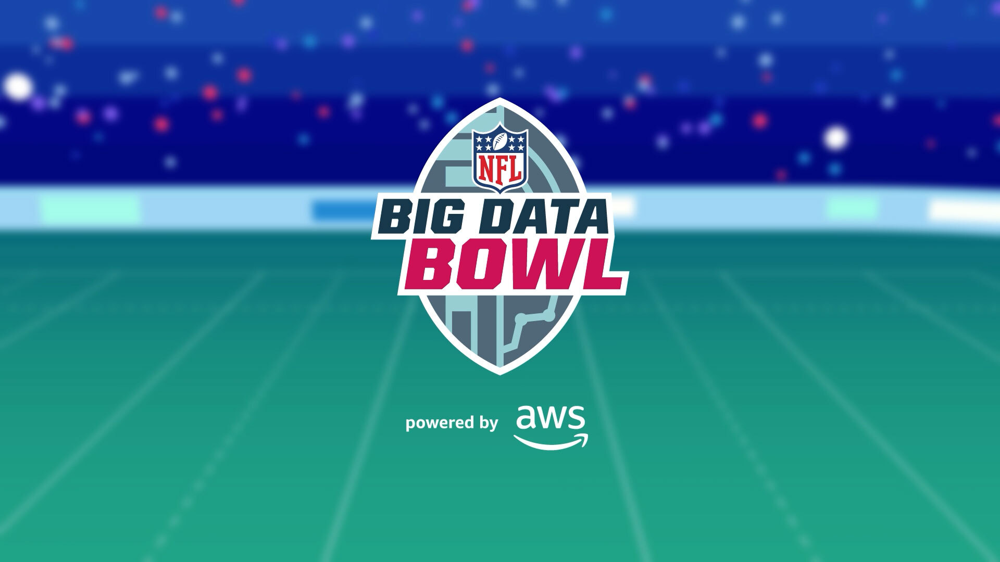
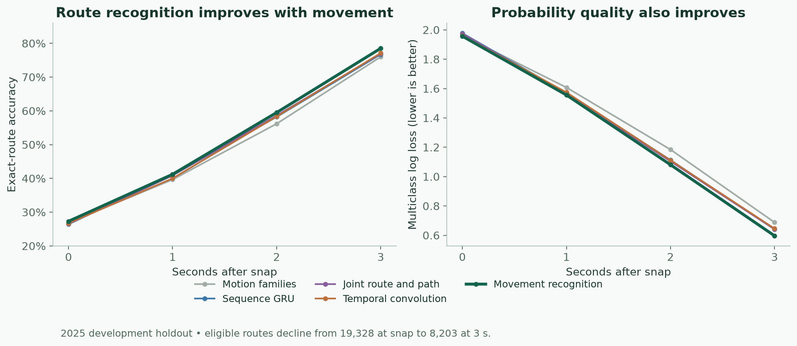

# NFL Big Data Bowl 2027

## Route Unpredictability

**David Driscoll · Applied Mathematics, Columbia University**



**Can Combine movement traits explain how long a receiver keeps a route difficult to recognize?**

This project turns causal route forecasts into a continuous measure of route unpredictability, then tests its reliability and relationship with Combine performance. It combines hierarchical route classification, recurrent and temporal convolution models, calibrated probabilities, numerical integration, and player-level statistical inference.

[Read the analysis](docs/writeup.md) · [Methods and limitations](docs/methodology.md) · [Reproduction notebook](analysis.ipynb) · [Source](src/) · [Results](results/)

## Measuring the whole observed route

For route $i$, let $p_{i,t}(r_i)$ be the probability assigned to its recorded route label using only information available through time $t$.

$$
U_i=\frac{100}{T_i}\int_0^{T_i}\left[1-p_{i,t}(r_i)\right]\,dt.
$$

The integral is evaluated on native **10 Hz** tracking frames. The window runs from snap to release/end, capped at three seconds. Higher values mean the model assigned less probability to the actual route throughout that window. Player scores adjust for route and play context; Brier score, entropy, and confidence diagnostics distinguish different sources of uncertainty.


## Evidence

| Measurement | Result |
|---|---:|
| Exact-route accuracy at 2 seconds | **59.5%** |
| Route-family accuracy at 2 seconds | **67.2%** |
| Exact-route accuracy on players absent from training, at 2 seconds | **58.6%** |
| Eligible routes scored in 2025 | **19,321** |
| Players meeting the 50-route / 5-game threshold | **74** |
| Player-score repeatability across disjoint game groups | **Spearman ρ = 0.36** |
| Agreement with the context-adjusted Brier score | **Spearman ρ = 0.91** |

The selected model blends a joint route-and-path GRU with a causal temporal convolution network. Training uses 2023–2024 games, with separate game groups for model selection and calibration. **2025 is a development holdout, not an untouched confirmatory sample.** Later observation times have fewer eligible routes.



**The current evidence does not establish a Combine-to-deception relationship.** None of the 36 planned Combine association tests survives false-discovery-rate correction (minimum $q=0.380$). The player-level relationship with provided separation at pass release is close to zero ($\rho=-0.06$, 95% bootstrap interval −0.30 to 0.22). Model unpredictability remains an exploratory measurement, not a validated scouting grade.

## Reproduce

Download the competition files from [Kaggle](https://www.kaggle.com/competitions/nfl-big-data-bowl-2027/data) through an authorized account. Place the nine CSVs together, then run:

```bash
python -m venv .venv
source .venv/bin/activate
pip install -r requirements.txt
python src/run.py --data /absolute/path/to/competition/csvs
```

The pipeline prepares native-rate sequences, fits and calibrates model candidates, evaluates probabilities, integrates route scores, extracts Combine features, and runs association and robustness analyses. Outputs and checkpoints remain under `.work/`. Training runs on CPU; the reference environment and optional figure/demo commands are documented in [methodology](docs/methodology.md).

The repository contains source, aggregate findings, and figures. Competition CSVs, row-level tracking, checkpoints, and locally generated play visualizations are excluded. NFL/AWS artwork is [attributed separately](https://raw.githubusercontent.com/ddrisco11/nfl-big-data-bowl-2027/main/assets/ATTRIBUTION.md).
