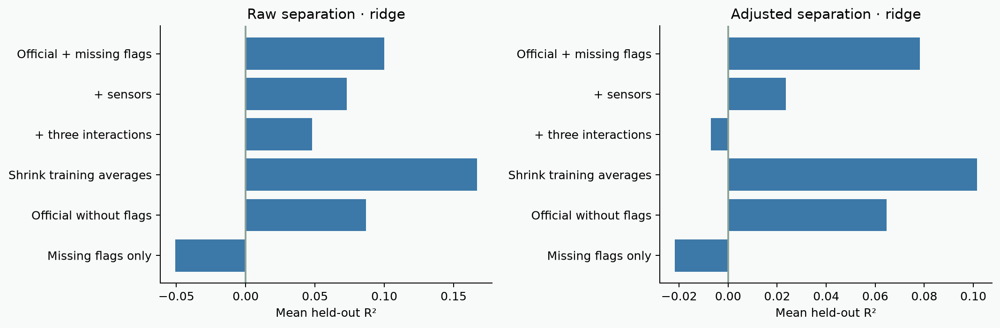
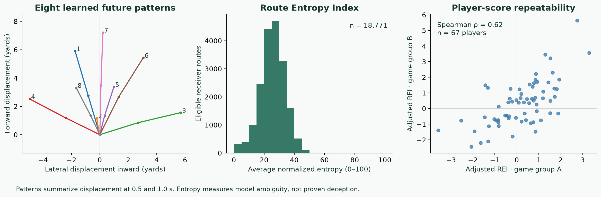
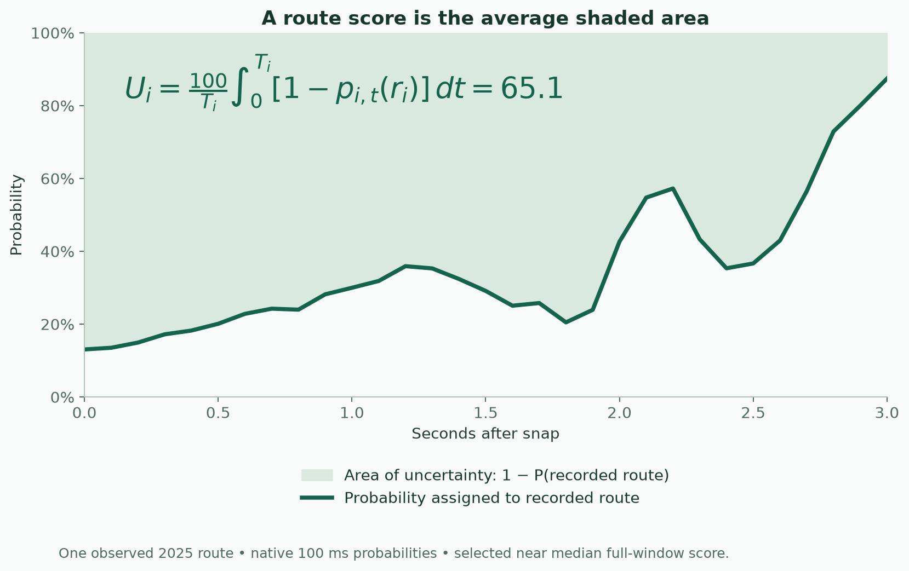

# NFL Big Data Bowl 2027

## Combine Movement, Separation, and Route Entropy

**David Driscoll · Applied Mathematics, Columbia University**


**Which Combine measurements translate into receiver separation—and can movement ambiguity explain part of that relationship?**

This project predicts receiver separation from official Combine results and sensor-derived movement, and studies uncertainty about recorded routes and future paths. It combines hierarchical route classification, recurrent and temporal convolution models, calibrated probabilities, numerical integration, and player-level statistical inference.

[Combine-to-separation study](docs/combine-separation.md) · [Route Entropy Index](docs/route-entropy-index.md) · [Route-label analysis](docs/writeup.md) · [Methods and limitations](docs/methodology.md) · [Reproduction notebook](analysis.ipynb) · [Source](src/) · [Results](results/)

## Combine results and receiver separation

Official body measurements and drill results are evaluated against sensor-derived speed, turning, braking, and exit-speed features. The outcome is each wide receiver’s mean separation at pass release, with a second target adjusted for route, coverage, initial cushion, time to throw, and other measured context.

The sample has **82 receivers and 30,566 observed separation measurements**. Three repetitions of nested five-fold player-held-out evaluation compare linear regression, ridge, elastic net, a neural network, CatBoost, and XGBoost.

| Ridge configuration | Raw-separation R² | Context-adjusted R² |
|---|---:|---:|
| Official Combine results | 0.100 | 0.078 |
| Official results + sensor features | 0.073 | 0.024 |
| Official results + shrinkage of noisy training averages | **0.167** | **0.101** |

These are mean held-out scores, not training fits. Uncertainty is substantial: the all-player shrinkage model’s conditional bootstrap R² intervals include zero. Sensor features and the three tested interactions do not establish added predictive value. Class-transfer results vary sharply, and receivers with more observations produce more stable targets. [Full comparisons, uncertainty, missingness audit, and reproduction](docs/combine-separation.md).



## Route Entropy Index

How many future movement patterns remain plausible as a receiver runs? A calibrated model predicts eight learned patterns for the next second, and their Shannon entropy is integrated at native **10 Hz**:

$$
\operatorname{REI}_i=\frac{100}{T_i\log 8}\int_0^{T_i}\left[-\sum_{k=1}^{8}p_{i,k}(t)\log p_{i,k}(t)\right]dt.
$$

Zero means one predicted pattern has all the probability; 100 means all eight remain equally likely throughout. This is model-based future-path ambiguity, not established deception or receiver value. Eligible forecast origins require a complete future second before release/end.



The prototype scores **18,771 routes**. Context-adjusted player scores have **0.62 rank correlation across disjoint game groups**. Future-pattern log loss is **0.486**, versus **1.242** for a context-and-speed baseline; these are eight-mode movement forecasts, not twelve-route classification results.

**Higher entropy does not currently imply better separation.** Across 71 players, raw REI correlates negatively with release separation (ρ = −0.56); after context adjustment the relationship is weaker (ρ = −0.26, exploratory 95% player-bootstrap interval −0.48 to −0.02). [Separation analysis](docs/route-entropy-index.md#relationship-with-separation-at-release).

**Defender reaction remains a feasibility study.** Coverage labels do not identify receiver–defender matchups, and the strict observable-pair screen retains only four candidates. The implemented movement-response lag handles anticipation and censoring, but cannot support player ratings and is not folded into REI. [Methods, diagnostics, and reproduction](docs/route-entropy-index.md).

## Recorded-route unpredictability

For route $i$, let $p_{i,t}(r_i)$ be the probability assigned to its recorded route label using only information available through time $t$.

$$
U_i=\frac{100}{T_i}\int_0^{T_i}\left[1-p_{i,t}(r_i)\right]\,dt.
$$

The integral is evaluated on native **10 Hz** tracking frames. The window runs from snap to release/end, capped at three seconds. Higher values mean the model assigned less probability to the actual route throughout that window. Player scores adjust for route and play context; Brier score, entropy, and confidence diagnostics distinguish different sources of uncertainty.



## Evidence

| Measurement | Result |
|---|---:|
| Exact-route accuracy at 2 seconds | **59.5%** |
| Route-family accuracy at 2 seconds | **67.2%** |
| Exact-route accuracy on players absent from training, at 2 seconds | **58.6%** |
| Eligible routes scored in 2025 | **19,321** |
| Players meeting the 50-route / 5-game threshold | **74** |
| Player-score repeatability across disjoint game groups | **Spearman ρ = 0.36** |
| Agreement with the context-adjusted Brier score | **Spearman ρ = 0.91** |

The selected model blends a joint route-and-path GRU with a causal temporal convolution network. Training uses 2023–2024 games, with separate game groups for model selection and calibration. **2025 is a development holdout, not an untouched confirmatory sample.** Later observation times have fewer eligible routes.


**The current evidence does not establish a Combine-to-deception relationship.** None of the 36 planned Combine association tests survives false-discovery-rate correction (minimum $q=0.380$). The player-level relationship with provided separation at pass release is close to zero ($\rho=-0.06$, 95% bootstrap interval −0.30 to 0.22). Model unpredictability remains an exploratory measurement, not a validated scouting grade.

## Reproduce

Download the competition files from [Kaggle](https://www.kaggle.com/competitions/nfl-big-data-bowl-2027/data) through an authorized account. Place the nine CSVs together, then run:

```bash
python -m venv .venv
source .venv/bin/activate
pip install -r requirements.txt
python src/run.py --data /absolute/path/to/competition/csvs
```

The pipeline prepares native-rate sequences, fits and calibrates model candidates, evaluates probabilities, integrates route scores, extracts Combine features, and runs association and robustness analyses. Outputs and checkpoints remain under `.work/`. Training runs on CPU; the reference environment and optional figure/demo commands are documented in [methodology](docs/methodology.md).

The repository contains source, aggregate findings, and figures. Competition CSVs, row-level tracking, checkpoints, and locally generated play visualizations are excluded. NFL/AWS artwork is [attributed separately](assets/ATTRIBUTION.md).
