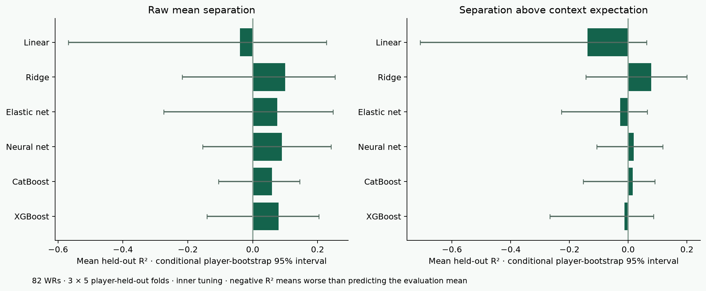
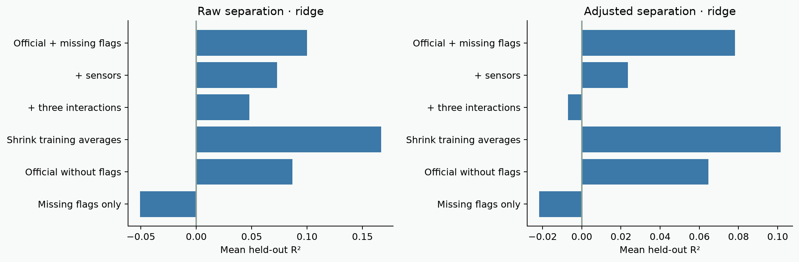

# Combine movement and receiver separation

One outcome per wide receiver: average provided separation at release across available regular-season plays. Official Combine measurements are compared with sensor-derived movement mechanics.

The sample contains 82 players and 30,566 observed separation measurements. Training-only preprocessing and identical player partitions allow paired comparisons.

## Repeated evaluation

| Model · official measurements | Raw R² | Raw Pearson r | Adjusted R² | Adjusted Pearson r |
|---|---:|---:|---:|---:|
| linear | -0.039 | 0.346 | -0.138 | 0.256 |
| ridge | 0.100 | 0.331 | 0.078 | 0.289 |
| elastic_net | 0.075 | 0.316 | -0.028 | 0.133 |
| neural_net | 0.090 | 0.319 | 0.019 | 0.173 |
| catboost | 0.060 | 0.250 | 0.016 | 0.164 |
| xgboost | 0.079 | 0.308 | -0.013 | 0.164 |



## Movement tracking, interactions, and uncertainty

| Ridge configuration | Raw R² | Adjusted R² |
|---|---:|---:|
| Official + missing flags | 0.100 | 0.078 |
| + sensors | 0.073 | 0.024 |
| + three interactions | 0.048 | -0.007 |
| Shrink training averages | 0.167 | 0.101 |
| Official without flags | 0.087 | 0.065 |
| Missing flags only | -0.051 | -0.022 |



## Minimum observation sensitivity

| Minimum observations | Players | Raw ridge R² | Adjusted ridge R² |
|---|---:|---:|---:|
| 1 | 82 | 0.100 | 0.078 |
| 25 | 74 | 0.195 | 0.157 |
| 50 | 68 | 0.197 | 0.203 |
| 100 | 62 | 0.283 | 0.299 |

## Draft-class transfer

| Configuration | Outcome | 2024 R² | 2025 R² |
|---|---|---:|---:|
| ridge · official | raw | -0.053 | 0.381 |
| ridge · official | adjusted | 0.012 | 0.221 |
| neural_net · official | raw | -0.183 | 0.419 |
| neural_net · official | adjusted | -0.065 | 0.178 |
| ridge · sensors | raw | -0.073 | 0.362 |
| ridge · sensors | adjusted | -0.028 | 0.136 |

## Missingness audit

- combine_height: 0.0% missing
- combine_weight: 0.0% missing
- hand_size: 0.0% missing
- arm_length: 0.0% missing
- wing_span: 0.0% missing
- ten_yd_split: 9.8% missing
- forty: 9.8% missing
- vertical: 13.4% missing
- broad_jump: 12.2% missing
- three_cone: 70.7% missing
- short_shuttle: 63.4% missing
- bench_reps: 70.7% missing

Event-derived time to throw is available for 99.5% of routes; ambiguous event times are excluded. The supplied dropback-duration column is almost entirely missing.

## Interpretation and methods

- Three repetitions of five-fold player-held-out outer evaluation. Three-fold inner tuning; same outer partitions for every configuration. No player outcomes enter both outer fitting and evaluation.
- Context target models are trained on outer-training players, with player-cross-fitted residuals for fitting targets and outer-training-only context predictions for evaluation players. Context models use route, coverage, formation, alignment, season, cushion, event-derived time to throw, down, distance, yard line, quarter, sideline distance.
- All configuration comparisons use raw held-out player averages or held-out context residual averages as truth, never shrunken held-out truth. Partial pooling shrinks training targets using outer-training between-player and within-player variances; the nuisance and pooling construction is fixed within inner tuning.
- Intervals resample players from fixed out-of-fold predictions. They do not refit models or account for shared games/teams and are exploratory. Repeat ranges describe split sensitivity, not confidence intervals.
- Draft-class tests train on earlier draft classes and evaluate 2024 or 2025. NFL outcomes use all available 2023–2025 careers, so these are class-transfer tests, not historically executable forecasts with equal follow-up.
- Nonparticipants and missing measurements are not random. Compare official values plus flags, values without flags, and flags alone. Sensor missingness may encode drill participation.
- Interactions were specified before evaluation: standardized speed95 × curl braking90; acceleration95 × slant speed retention; weight × shuttle time. Signs are not constrained. No causal interpretation is claimed.
- 2025 has been examined repeatedly. These are exploratory analyses with no pristine confirmatory holdout. Model/configuration selection after seeing these results needs an independent confirmation.

Exact fold metrics, bootstrap intervals, paired MSE differences, and selected parameters are in results.json and parameters.json.

## Reproduce

After running the main source pipeline (which creates `.work/base` and `.work/results/combine-features.csv`), run:

```bash
python src/run_combine.py --data /absolute/path/to/competition/csvs
```

The output directory holds row-level local data and aggregate results. Public results contain no player identifiers or raw tracking. Official measurements include size, limb dimensions, sprint splits, jumps, three-cone, shuttle and bench. Sensor features include 40-yard speed/acceleration plus matched slant-left and curl-right speed, turning, braking and exit-speed summaries. Only these two matched receiver drills were audited here; this is not a search across every Combine drill.

Partial-pooling sampling variance uses within-player play variance divided by observation count. Plays within games are correlated, so those reliability weights may be too optimistic. The nuisance adjustment and shrinkage parameters are fixed at the outer-training level during inner tuning; the final outer-player evaluation remains independent of those fitted parameters. The adjusted target removes measured opportunity context and should not be interpreted as a fully isolated causal player effect.

No claim that these models estimate movement unpredictability is made: their outcome is observed release separation.
