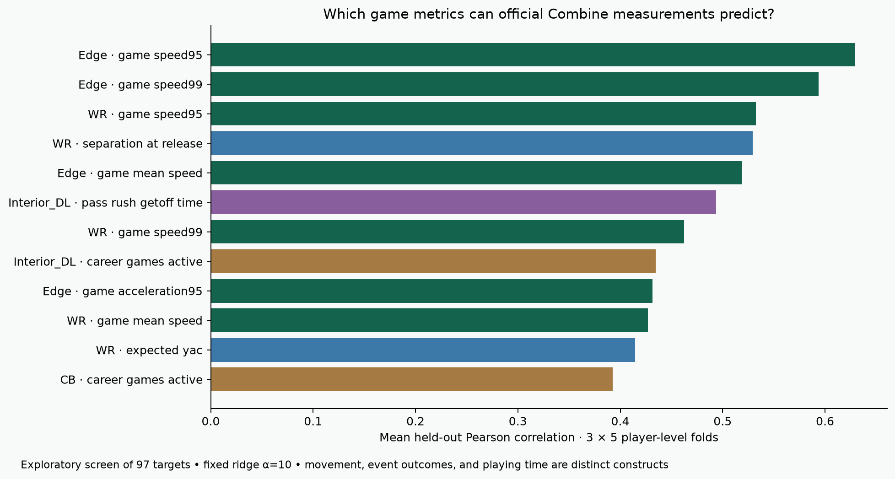

# Broad Combine-to-game predictive screen

A deliberately small model surveys which available game measurements can be predicted from official Combine results and body dimensions. Targets are aggregated by player and evaluated separately within seven position groups.

**Model:** fixed ridge linear regression, alpha=10; 12 official measurements plus training-fold missingness indicators. No sensor features, draft year, or identity enter the main prediction. Three repeated five-fold player-held-out partitions produce the reported correlations. No target-dependent model tuning is performed.

**Scope:** 97 group/target pairs, minimum 30 eligible players per pair, and metric-specific minimum observed events. Missing outcome values are excluded; they are not silently converted to zero.

## Highest correlations

| Group | Target | Players | Pearson r | Held-out R² | Exploratory FDR q |
|---|---|---:|---:|---:|---:|
| Edge | game speed95 | 56 | 0.629 | 0.375 | 0.014 |
| Edge | game speed99 | 56 | 0.594 | 0.316 | 0.014 |
| WR | game speed95 | 80 | 0.532 | 0.259 | 0.014 |
| WR | separation at release | 74 | 0.529 | 0.252 | 0.014 |
| Edge | game mean speed | 56 | 0.519 | 0.211 | 0.014 |
| Interior_DL | pass rush getoff time | 37 | 0.494 | 0.174 | 0.057 |
| WR | game speed99 | 80 | 0.462 | 0.177 | 0.014 |
| Interior_DL | career games active | 40 | 0.435 | 0.143 | 0.057 |
| Edge | game acceleration95 | 56 | 0.431 | 0.115 | 0.054 |
| WR | game mean speed | 80 | 0.427 | 0.141 | 0.014 |
| WR | expected yac | 65 | 0.414 | 0.122 | 0.024 |
| CB | career games active | 48 | 0.393 | 0.119 | 0.057 |
| CB | sack credit per recorded pass rush observation | 44 | 0.333 | -0.054 | 0.110 |
| Interior_DL | sack credit per recorded pass rush observation | 38 | 0.330 | 0.035 | 0.145 |
| Edge | pass rush getoff time | 51 | 0.311 | -0.060 | 0.133 |



## Interpretation

The clearest signal is physical transfer: Combine measurements predict high-end game speed, particularly among edge players. This is not equivalent to predicting sacks or coverage quality. Receiver separation remains a leading performance outcome in this screen. Interior defensive-line get-off time is a smaller-sample candidate. Expected YAC is itself a model-derived contextual expectation, not actual YAC above expectation.

The receiver-separation sample requires at least 25 nonmissing observations and contains 74 players, so it is not directly comparable to the earlier all-82-player experiment. A high correlation with negative R² can indicate poor calibration and is not a good predictive model by itself.

## Controls and target definitions

A separate ridge baseline predicts each target using position subgroup and draft class only. Adding Combine measurements to this metadata is evaluated on identical folds. This checks whether a signal is largely an exposure/class or broad-role effect. It is a descriptive sensitivity check, not causal adjustment.

Per-target descriptions, sample sizes, observation thresholds, repeat ranges, RMSE, metadata baselines, and incremental R² are in `results.json`. Movement speed/acceleration uses recorded cohort frames from snap through release/end, capped at three seconds. Outcomes pool 2023–2025; career summaries have unequal follow-up. Starting cushion is deployment context. Pressure times are conditional on recorded pressure events, and tackle share is conditional on recorded tackle events.

## Multiple testing and uncertainty

For each target, 1,000 shuffled-player-outcome regressions are evaluated with the same fixed features and partitions. Exact linear prediction operators make these refits cheap. Positive-correlation permutation p-values receive one Benjamini–Hochberg correction across all 97 tested group/target pairs. Team, class and heteroskedastic effects can challenge outcome exchangeability, so q-values are exploratory rather than definitive discovery claims.

The top targets additionally receive player-bootstrap intervals and later-draft-class transfer checks, stored in `top-target-sensitivity.json`. These do not undo selection of the targets from this dataset. Independent data is needed before claiming that any target generalizes.

## Complete ranking

| Group | Target | Category | N | Pearson r | R² | ΔR² vs metadata | q |
|---|---|---|---:|---:|---:|---:|---:|
| Edge | game_speed95 | movement | 56 | 0.629 | 0.375 | 0.177 | 0.014 |
| Edge | game_speed99 | movement | 56 | 0.594 | 0.316 | 0.157 | 0.014 |
| WR | game_speed95 | movement | 80 | 0.532 | 0.259 | 0.262 | 0.014 |
| WR | separation_at_release | receiving | 74 | 0.529 | 0.252 | 0.247 | 0.014 |
| Edge | game_mean_speed | movement | 56 | 0.519 | 0.211 | 0.152 | 0.014 |
| Interior_DL | pass_rush_getoff_time | pass_rush | 37 | 0.494 | 0.174 | 0.051 | 0.057 |
| WR | game_speed99 | movement | 80 | 0.462 | 0.177 | 0.197 | 0.014 |
| Interior_DL | career_games_active | playing_time | 40 | 0.435 | 0.143 | 0.025 | 0.057 |
| Edge | game_acceleration95 | movement | 56 | 0.431 | 0.115 | 0.004 | 0.054 |
| WR | game_mean_speed | movement | 80 | 0.427 | 0.141 | 0.131 | 0.014 |
| WR | expected_yac | receiving | 65 | 0.414 | 0.122 | 0.115 | 0.024 |
| CB | career_games_active | playing_time | 48 | 0.393 | 0.119 | -0.049 | 0.057 |
| CB | sack_credit_per_recorded_pass_rush_observation | pass_rush | 44 | 0.333 | -0.054 | 0.065 | 0.110 |
| Interior_DL | sack_credit_per_recorded_pass_rush_observation | pass_rush | 38 | 0.330 | 0.035 | 0.077 | 0.145 |
| Edge | pass_rush_getoff_time | pass_rush | 51 | 0.311 | -0.060 | 0.011 | 0.133 |
| Safety | game_speed99 | movement | 39 | 0.301 | -0.106 | -0.060 | 0.160 |
| CB | career_defensive_snaps | playing_time | 48 | 0.296 | -0.025 | -0.054 | 0.160 |
| OL | peak_pressure_probability_allowed | blocking | 76 | 0.276 | -0.018 | -0.148 | 0.097 |
| OL | career_games_started_per_active_game | playing_time | 90 | 0.234 | -0.050 | -0.034 | 0.110 |
| OL | career_offensive_snaps_per_active_game | playing_time | 90 | 0.226 | -0.056 | -0.043 | 0.166 |
| OL | game_acceleration95 | movement | 88 | 0.226 | -0.058 | -0.038 | 0.145 |
| Interior_DL | game_speed95 | movement | 42 | 0.207 | -0.092 | 0.009 | 0.364 |
| CB | game_acceleration95 | movement | 48 | 0.196 | -0.131 | -0.115 | 0.364 |
| TE | game_speed99 | movement | 31 | 0.188 | -0.167 | 0.069 | 0.426 |
| Interior_DL | game_mean_speed | movement | 42 | 0.183 | -0.159 | -0.131 | 0.399 |
| Interior_DL | game_acceleration95 | movement | 42 | 0.172 | -0.154 | -0.075 | 0.426 |
| Safety | career_games_started_per_active_game | playing_time | 40 | 0.160 | -0.300 | -0.355 | 0.451 |
| OL | game_mean_speed | movement | 88 | 0.159 | -0.110 | -0.210 | 0.362 |
| WR | starting_cushion | deployment | 75 | 0.157 | -0.142 | -0.125 | 0.339 |
| Safety | game_acceleration95 | movement | 39 | 0.149 | -0.253 | -0.272 | 0.426 |
| Safety | career_defensive_snaps_per_active_game | playing_time | 40 | 0.145 | -0.268 | -0.308 | 0.451 |
| WR | yards_per_recorded_reception | receiving | 59 | 0.144 | -0.114 | -0.097 | 0.426 |
| WR | yac_above_expected | receiving | 54 | 0.142 | -0.138 | -0.204 | 0.426 |
| CB | career_games_started | playing_time | 48 | 0.137 | -0.227 | -0.255 | 0.464 |
| TE | game_speed95 | movement | 31 | 0.137 | -0.225 | 0.033 | 0.464 |
| OL | career_special_teams_snaps_per_active_game | playing_time | 90 | 0.132 | -0.121 | -0.139 | 0.406 |
| Interior_DL | career_defensive_snaps_per_active_game | playing_time | 40 | 0.130 | -0.156 | -0.020 | 0.464 |
| Interior_DL | game_speed99 | movement | 42 | 0.128 | -0.194 | -0.345 | 0.451 |
| Edge | career_special_teams_snaps | playing_time | 54 | 0.121 | -0.123 | -0.114 | 0.451 |
| CB | starting_cushion | deployment | 46 | 0.113 | -0.199 | -0.059 | 0.464 |
| OL | career_offensive_snaps | playing_time | 84 | 0.111 | -0.131 | -0.206 | 0.426 |
| OL | career_games_started | playing_time | 84 | 0.111 | -0.136 | -0.208 | 0.451 |
| Interior_DL | career_defensive_snaps | playing_time | 40 | 0.098 | -0.229 | -0.198 | 0.474 |
| WR | target_rate_on_routes | receiving | 75 | 0.097 | -0.141 | -0.106 | 0.464 |
| CB | career_defensive_snaps_per_active_game | playing_time | 47 | 0.080 | -0.249 | -0.196 | 0.522 |
| WR | yards_after_catch | receiving | 59 | 0.079 | -0.228 | -0.217 | 0.474 |
| WR | career_offensive_snaps_per_active_game | playing_time | 79 | 0.077 | -0.169 | -0.107 | 0.474 |
| Safety | career_games_active | playing_time | 38 | 0.074 | -0.470 | -0.617 | 0.553 |
| OL | career_special_teams_snaps | playing_time | 84 | 0.065 | -0.149 | -0.241 | 0.495 |
| OL | game_speed95 | movement | 88 | 0.059 | -0.179 | -0.228 | 0.495 |
| OL | pass_rushers_encountered | blocking | 76 | 0.054 | -0.169 | -0.135 | 0.531 |
| TE | game_mean_speed | movement | 31 | 0.034 | -0.401 | -0.369 | 0.636 |
| Safety | career_games_started | playing_time | 38 | 0.029 | -0.379 | -0.274 | 0.636 |
| CB | game_speed99 | movement | 48 | 0.024 | -0.267 | -0.250 | 0.639 |
| Safety | game_speed95 | movement | 39 | 0.019 | -0.442 | -0.444 | 0.639 |
| WR | career_games_started_per_active_game | playing_time | 79 | 0.008 | -0.216 | -0.168 | 0.639 |
| OL | extended_sack_allowed_rate | blocking | 76 | 0.006 | -0.189 | -0.189 | 0.639 |
| OL | pressure_allowed_rate | blocking | 76 | 0.005 | -0.237 | -0.195 | 0.639 |
| Edge | career_games_active | playing_time | 54 | -0.009 | -0.278 | -0.119 | 0.704 |
| Interior_DL | career_special_teams_snaps | playing_time | 40 | -0.010 | -0.415 | -0.113 | 0.639 |
| CB | game_speed95 | movement | 48 | -0.020 | -0.379 | -0.324 | 0.736 |
| OL | career_games_active | playing_time | 84 | -0.038 | -0.235 | -0.155 | 0.736 |
| Safety | career_defensive_snaps | playing_time | 38 | -0.040 | -0.461 | -0.257 | 0.754 |
| Safety | sack_credit_per_recorded_pass_rush_observation | pass_rush | 36 | -0.042 | -0.367 | -0.351 | 0.754 |
| Edge | time_to_hurry_when_recorded | pass_rush | 33 | -0.054 | -0.364 | -0.441 | 0.754 |
| Interior_DL | career_special_teams_snaps_per_active_game | playing_time | 40 | -0.062 | -0.534 | -0.110 | 0.778 |
| Safety | starting_cushion | deployment | 30 | -0.073 | -0.534 | -0.194 | 0.756 |
| OL | sack_allowed_rate | blocking | 76 | -0.074 | -0.242 | -0.244 | 0.804 |
| Edge | time_to_pressure_when_recorded | pass_rush | 33 | -0.085 | -0.407 | -0.501 | 0.778 |
| Edge | career_defensive_snaps_per_active_game | playing_time | 55 | -0.085 | -0.295 | -0.272 | 0.804 |
| Safety | game_mean_speed | movement | 39 | -0.094 | -0.628 | -0.614 | 0.804 |
| Safety | career_special_teams_snaps_per_active_game | playing_time | 40 | -0.095 | -0.642 | -0.584 | 0.813 |
| CB | game_mean_speed | movement | 48 | -0.106 | -0.592 | -0.532 | 0.813 |
| WR | career_games_started | playing_time | 75 | -0.114 | -0.334 | -0.194 | 0.831 |
| TE | career_special_teams_snaps_per_active_game | playing_time | 33 | -0.120 | -0.676 | -0.201 | 0.813 |
| TE | game_acceleration95 | movement | 31 | -0.129 | -0.384 | -0.408 | 0.824 |
| Interior_DL | career_games_started_per_active_game | playing_time | 40 | -0.130 | -0.499 | -0.246 | 0.813 |
| Edge | career_games_started | playing_time | 54 | -0.137 | -0.349 | -0.183 | 0.831 |
| Interior_DL | career_games_started | playing_time | 40 | -0.140 | -0.535 | -0.363 | 0.824 |
| Edge | career_defensive_snaps | playing_time | 54 | -0.145 | -0.364 | -0.125 | 0.865 |
| CB | career_games_started_per_active_game | playing_time | 47 | -0.149 | -0.530 | -0.510 | 0.861 |
| WR | career_offensive_snaps | playing_time | 75 | -0.155 | -0.369 | -0.150 | 0.906 |
| WR | game_acceleration95 | movement | 80 | -0.158 | -0.364 | -0.287 | 0.906 |
| TE | career_games_started_per_active_game | playing_time | 33 | -0.166 | -0.808 | -0.861 | 0.831 |
| Edge | career_games_started_per_active_game | playing_time | 55 | -0.187 | -0.351 | -0.330 | 0.926 |
| WR | career_special_teams_snaps | playing_time | 75 | -0.207 | -0.447 | -0.483 | 0.947 |
| CB | solo_tackle_share_of_recorded_tackle_events | defending | 33 | -0.210 | -0.496 | -0.285 | 0.879 |
| Safety | career_special_teams_snaps | playing_time | 38 | -0.226 | -0.616 | -0.717 | 0.942 |
| CB | career_special_teams_snaps | playing_time | 48 | -0.242 | -0.483 | -0.510 | 0.949 |
| Edge | career_special_teams_snaps_per_active_game | playing_time | 55 | -0.249 | -0.409 | -0.415 | 0.947 |
| WR | career_special_teams_snaps_per_active_game | playing_time | 79 | -0.250 | -0.417 | -0.401 | 0.968 |
| OL | game_speed99 | movement | 88 | -0.257 | -0.353 | -0.453 | 0.968 |
| WR | career_games_active | playing_time | 75 | -0.266 | -0.380 | -0.209 | 0.968 |
| TE | career_offensive_snaps_per_active_game | playing_time | 33 | -0.273 | -0.991 | -1.122 | 0.947 |
| Edge | sack_credit_per_recorded_pass_rush_observation | pass_rush | 48 | -0.303 | -0.569 | -0.278 | 0.966 |
| OL | time_to_pressure_allowed_when_recorded | blocking | 66 | -0.321 | -0.489 | -0.500 | 0.968 |
| CB | career_special_teams_snaps_per_active_game | playing_time | 47 | -0.399 | -0.664 | -0.662 | 0.979 |

## Reproduce

Run the base preparation pipeline first, and provide the authorized competition CSV directory:

```bash
export NFL_DATA_DIR=/absolute/path/to/competition/csvs
mkdir -p .work/performance-screen
python src/survey_movement.py
python src/survey_screen.py
python src/survey_report.py
```

The defaults use `.work/base` and `.work/performance-screen`. `NFL_BASE_WORK` and `NFL_SCREEN_OUTPUT` override them. Local files contain player-level outcomes and predictions; the public repository includes only aggregate results and anonymous figures. Edge combines DE and OLB, interior defensive line combines DT and NT, and safety combines FS and SS; subgroup metadata sensitivity is reported because these roles differ.
