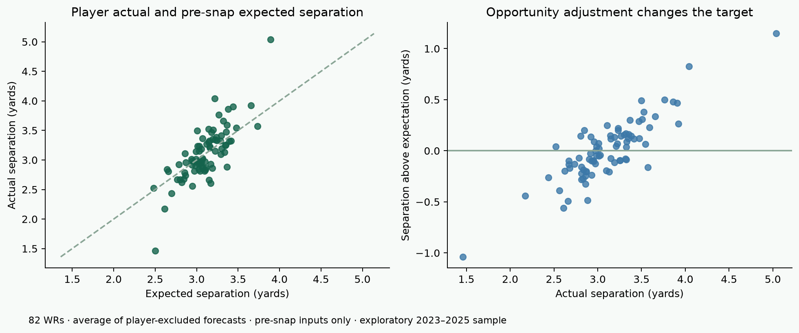

# Separation above pre-snap expectation

For a receiver on play i, the population model estimates expected separation from beginning-of-play information. It pools all available WR observations in its training partition. It does not use the receiver’s identity or average separation as an input.

$$\widehat{s}_i=f_{\mathrm{WR}}(X_{i,\mathrm{snap}}),\qquad \mathrm{SAE}_a=\frac{1}{N_a}\sum_{i:a(i)=a}(s_i-\widehat{s}_i).$$

A positive receiver value means more separation than expected for the starting situation. If a verified defender-level separation-allowed outcome were available, the useful defensive sign would be reversed: expected minus observed separation allowed.

## Defensive-back feasibility

| Position | Regular-season rows | Release-separation observations |
|---|---:|---:|
| CB | 34,760 | 0 |
| FS | 10,260 | 0 |
| SS | 18,529 | 0 |

There are no observed release-separation outcomes on CB, FS or SS rows. Coverage roles do not identify the covered receiver. With incomplete defender tracking, receiver separation cannot reliably be assigned to the nearest recorded DB. No defensive-back separation model is fitted.

## Expected-separation model

Candidates are ridge regression, histogram gradient boosting and CatBoost regression. Separation is continuous, so the model is a regressor. A classifier would require arbitrary separation bins. Candidate selection uses inner player-grouped validation; the outer evaluated player never fits or selects the expected-value model. The entire process repeats across three five-fold player partitions.

Inputs: offense_formation, receiver_alignment, lined_up_position, in_motion_at_ball_snap, possession_team, defense_team, season, down, yards_to_go, quarter, clock_seconds, score_margin, own_yardline, cushion, snap_y, snap_x.

Recorded route, realized coverage, time to throw, target status, pass outcomes, player identity and Combine variables are excluded. Cushion is treated as the supplied starting-distance measurement. Team identifiers and season are available before the play and help represent scheme and opponent context, but cannot fully isolate player effects.

Average route-level held-out R² is **0.172**, RMSE **1.922 yards**, and Pearson correlation **0.415**. These are route-level forecasting metrics, distinct from player-average prediction metrics.

Selected model counts: {'hist_gradient_boosting': 15}.



## Combine prediction of the new above-expected target

Only official Combine measurements and body dimensions enter the following models. Targets are mean receiver residuals from the pre-snap population model. Training-player residuals are cross-fitted. Outer test-player residuals are predicted by the baseline fitted only on training players.

| Model | Mean held-out R² | Mean Pearson r |
|---|---:|---:|
| catboost | 0.041 | 0.212 |
| elastic_net | -0.063 | 0.133 |
| linear | -0.135 | 0.289 |
| neural_net | 0.011 | 0.152 |
| ridge | 0.080 | 0.290 |
| xgboost | 0.012 | 0.215 |

Across the 82 player summaries, raw average separation and above-expected separation have Spearman correlation **0.764**. The above-expected player estimates have SD **0.299 yards**. The previous richer adjustment and the new pre-snap-only adjustment correlate at 0.859–0.862 across repeat-specific player estimates.

## Limits

- All receivers contribute to fitting the population expectation when in a training fold; no baseline is fit separately to each player average.
- WR population only. Tight ends, safeties and cornerbacks require their own outcome definitions/population baselines.
- Cushion is treated as a supplied starting-condition measure; snap position and pre-snap situation are included. Actual separation is only the dependent variable.
- Route-level baseline candidates are selected by player-grouped inner validation. Training-player residuals use cross-fitted baseline predictions. Outer evaluation players do not fit or select the nuisance model or Combine weights.
- Nested player partitions do not exclude shared games or teams; team context is known pre-snap and can capture scheme and roster effects. Residuals are descriptive above expectation, not isolated causal player skill.
- The same previously examined 2023–2025 data is used. Repeated validation is exploratory, not pristine confirmation.
- Positive receiver residual means more separation than expected. For confirmed DB outcomes the useful sign would reverse: expected separation allowed minus actual separation allowed. Those DB outcomes are unavailable; no nearest-recorded-player substitute is used.

## Reproduce

Run the main preparation and Combine comparison pipelines first (`src/run.py`, then `src/run_combine.py`). They create `.work/base`, `.work/combine-upgrades`, and the comparison cache. Then run:

```bash
mkdir -p .work/presnap
python src/presnap_run.py
python src/presnap_report.py
```

Optional environment overrides are `NFL_BASE_WORK`, `NFL_COMBINE_OUTPUT`, and `NFL_PRESNAP_OUTPUT`. Row-level expected separation and player summaries stay local; only aggregate figures and statistics are included publicly. The previous retrospective context adjustment is retained as a sensitivity comparison; the beginning-of-play model is the appropriate expectation for this pre-snap question.
