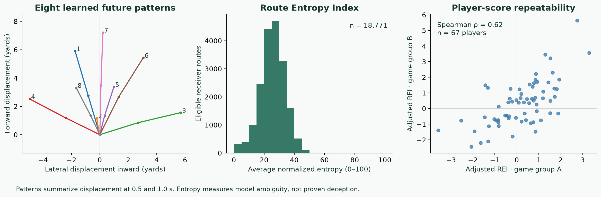
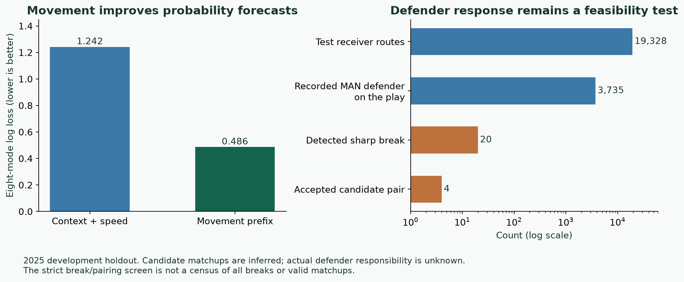

# Route Entropy Index

**David Driscoll · NFL Big Data Bowl 2027**

Route Entropy Index (REI) measures the uncertainty of a forecast over a receiver's next second of movement. It complements recorded-route recognition with a target defined by future displacement, independently of route names or Combine measurements.

## Why entropy is the right word

At each native 100 ms frame, the model assigns probabilities to eight possible movement patterns. Shannon entropy measures how evenly probability is distributed across those alternatives:

$$
H_i(t;h)=-\sum_{k=1}^{K}p_{i,k}(t;h)\log p_{i,k}(t;h),\qquad K=8,\ h=1\text{ second}.
$$

The route-level index is the duration-normalized integral:

$$
\boxed{\operatorname{REI}_i=\frac{100}{T_i\log K}\int_0^{T_i}H_i(t;1)\,dt.}
$$

The trapezoidal rule evaluates the integral at 10 Hz. Certainty in one mode scores zero; an equal probability on all eight modes throughout scores 100. The effective number of alternatives at a frame is $\exp(H_i(t;1))$. Neither score requires knowing the eventual route label.

This is **predictive entropy over a defined movement vocabulary**. It is not intrinsic randomness, measured defender confusion, or a verified player skill. A poorly informed model can have high entropy. A confidently wrong model can have low entropy. Calibration and outcome validation are therefore essential. Dispersion of coordinates alone would not be Shannon entropy, and response delay in seconds cannot simply be added to an entropy score.

## Future-path ambiguity

Training futures are represented by forward and inward-lateral displacement at 0.5 and 1.0 seconds after each forecast origin. Mini-batch k-means learns eight patterns from training games only. Each mode represents a coarse two-point future path, not a named football route or the entire continuous trajectory. The same dictionary is used for all evaluated players.



The movement model uses current and lagged position, speed, acceleration, and velocity; prefix means and variation; elapsed time; alignment; formation; position; down; distance; and field location. The baseline has the same static context, elapsed time, and current speed. Both use histogram gradient-boosted classifiers with 100 iterations, 15 leaves, learning rate 0.08, and L2 penalty 20. Training samples every fourth native forecast origin. Predictions are produced every 0.1 seconds. Temperature is chosen using calibration games.

The existing 2023–2024 training, selection, and calibration partitions are preserved. 2025 remains a development holdout. No 2025 labels, Combine variables, player identifiers, or future positions fit the forecasting model. Future positions define training targets and evaluation eligibility only.

A scored forecast origin must have its entire future second observed before release/end. Thus the integral stops one second before the last eligible receiver frame, or at three seconds after snap, whichever comes first. At least 0.5 seconds of contiguous forecast origins is required. This changes the population and weights toward longer-observed plays; it is not an integral over every receiver's complete route.

## Forecast validation

| 2025 measurement | Context + speed | Movement prefix |
|---|---:|---:|
| Eight-mode log loss | 1.242 | **0.486** |
| Eight-mode accuracy | 48.9% | **80.6%** |
| Multiclass Brier loss | 0.620 | **0.273** |
| Ten-bin top-label calibration error | 0.81 percentage points | **0.67 percentage points** |
| Energy score over the four-dimensional future vector | 1.957 | **1.290** |

These measurements use 374,145 eligible frames, not independent plays. A game bootstrap gives a movement-minus-baseline log-loss difference of −0.756, with a 95% interval of −0.764 to −0.747. A deterministic constant-velocity forecast has energy score 1.874 on the same future vectors.

The energy score evaluates the discrete distribution over cluster centers; within-mode variability is not modeled. Its units refer to the Euclidean norm of a four-dimensional displacement vector, not ordinary endpoint error. It is used alongside mode log loss because selecting only the closest predicted path can reward overly broad forecasts. See [Shahroudi, Lepson, and Kull, ICML 2024](https://proceedings.mlr.press/v235/shahroudi24a.html).

The nominal 90% mode set covers 97.2% of observed modes and contains 1.75 modes on average. Discrete cumulative sets overshoot their nominal probability, so this is a conservative set-coverage diagnostic, not evidence of exact 90% calibration. Top-label calibration likewise does not establish player-conditional or full-distribution calibration.

## Player estimates

The index covers **18,771 routes, 96 players, and 74 players with at least 50 routes across five games**. The mean route REI is 25.6.

A validation-fitted ridge model adjusts for recorded route, position, coverage category, observed duration, mean speed, and initial cushion. The adjusted player score averages residual REI across routes; it is in index points and is not itself constrained to 0–100. Bootstrap intervals resample games within a player. Observed mean speed and route are retrospective adjustment variables, not forecasting inputs from the future.

Adjusted scores have **Spearman correlation 0.62** between disjoint game groups among 67 players with at least 25 routes in each group. This is a preliminary repeatability result. Different labels, horizons, and eligibility prevent treating it as a direct improvement over recorded-route unpredictability. Team/scheme effects and uncertainty from fitting the model remain.

## Defender movement-response lag

Defender response is kept as a separate feasibility analysis. The supplied coverage fields identify roles such as `MAN`, but do not identify the receiver a defender is responsible for. Tracking omits players outside the prospect cohort.

The implemented screen:

1. Detects a receiver heading change of at least 35 degrees using a three-frame pre/post comparison, with a persistent turn, prebreak speed at least three yards/second, and postbreak speed at least two.
2. Selects the closest **recorded MAN-role candidate** within four yards at the break, requiring a one-yard margin over other recorded MAN candidates and no competing recorded receiver nearly as close.
3. Detects a sustained increase in defender lateral velocity toward the receiver's break, relative to that defender's prebreak baseline. The default threshold is one yard/second; 0.75 and 1.25 are sensitivity checks.
4. Searches lags from −0.2 to +1.0 seconds. Negative values represent anticipatory movement. Events require three-frame persistence and are confirmed 0.2 seconds after onset. Missing or insufficient follow-up is right-censored, never assigned an artificial delay.

$$
L_{i,b}=t_{\text{candidate movement onset}}-t_{\text{receiver break onset}}.
$$

Both onsets are retrospective operational definitions. Shared movement geometry, anticipation, backpedaling, and an incorrect matchup can all affect this proxy; it is not a measured perceptual reaction time.



Of 19,328 test receiver routes, 3,735 occur on plays with a recorded MAN-role defender. The strict break screen finds 20 events; pairing checks retain **only four candidate pairs**. At the default movement threshold, three have an observed response and one is censored. Two observed responses begin at or before the detected receiver break. This is insufficient for player rankings, associations with REI, or a Combine-to-reaction claim. The counts are specific to these screening rules; they do not mean that only 20 real breaks occurred.

The implementation is useful as a reproducible audit and a starting point for confirmed-matchup data. Defender lag remains excluded from REI. Full tracking plus verified coverage responsibility is needed for a credible response-delay outcome.

## Reproduce and extend

After preparing the native-rate arrays with the main pipeline:

```bash
python src/entropy.py --work .work/models --output .work/rei
python src/verify_entropy.py --work .work/models --output .work/rei
python src/defender_response.py --data /absolute/path/to/csvs --base .work/base --work .work/models --output .work/rei
python src/entropy_figures.py --output .work/rei --figures figures
```

Checks cover future-input invariance, exclusion of route labels/IDs/Combine features from inputs, entropy endpoints, refusal to bridge missing timestamps, anticipatory responses, persistence, and censoring. Local exports include per-route REI, player estimates, candidate-pair records, probabilities, and the fitted model. Public outputs contain only summary statistics and figures; mode centers aggregate training futures and are not individual player coordinates.

The next validation steps are sensitivity to the number of modes and forecast horizon, fixed-window comparisons, player-conditional calibration, independent-game evaluation, and a prespecified Combine association analysis. A future response-delay analysis also needs manual matchup/turn annotation or independently verified responsibilities before interpreting the proxy as defender behavior.
