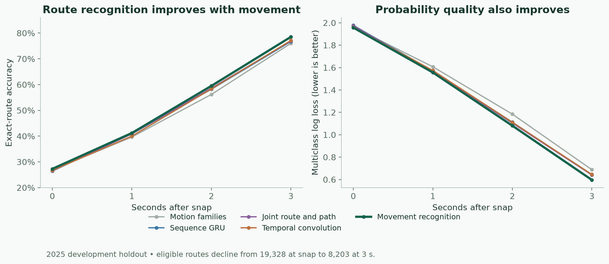
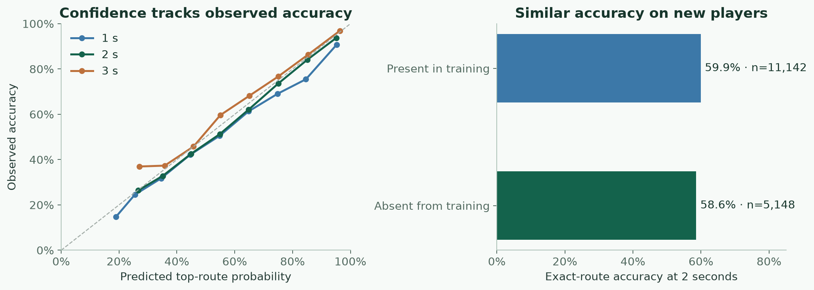
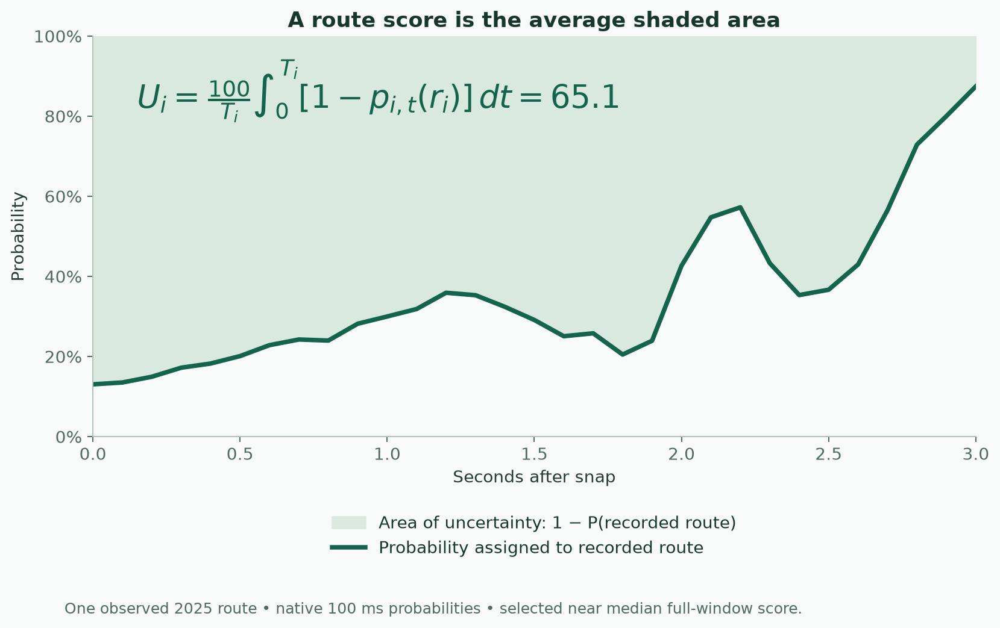
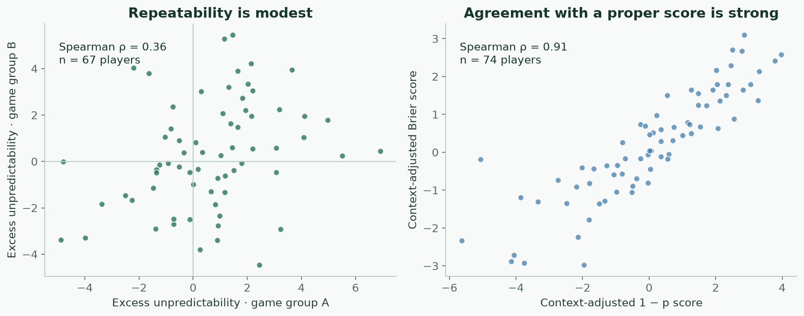
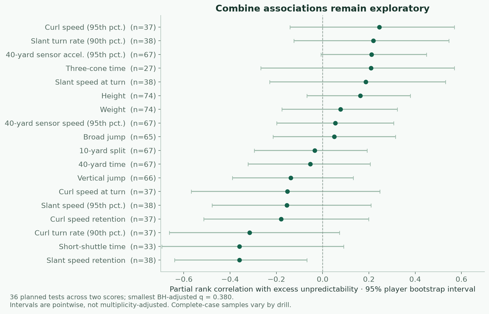

# Route Unpredictability: From Combine Movement to NFL Route Recognition

**David Driscoll · NFL Big Data Bowl 2027**

A receiver who keeps several routes plausible may delay a defender’s commitment. Combine drills measure speed and changes of direction, but whether those traits translate into disguised NFL routes is an empirical question. This analysis builds a movement-based recognition model, integrates its uncertainty over each route, and tests whether the resulting player measure relates to Combine performance and separation.

## 1. Recognizing a route as it unfolds

The sample contains regular-season wide receiver and tight end routes with recorded route labels. Tracking is normalized for direction and field side. Inputs include one second before the snap, observed movement, alignment, formation, and aggregates of other available tracked players. The data covers a prospect cohort, so those aggregates do not describe all 22 players.

Twelve exact route labels are grouped into six families: vertical, in-breaking, out-breaking, crossing, stop, and underneath. Hierarchical trees estimate family probabilities and conditional route probabilities. Sequence models learn directly from native 100 ms observations. A joint GRU also predicts future locations as auxiliary training targets; those future positions never enter its prediction inputs. A causal temporal convolution network supplies a complementary sequence model.

Training uses 2023–2024 games. Held-out games from those seasons are divided into model-selection and calibration groups. The selected recognition model is an equal-weight blend of the joint GRU and temporal convolution model, followed by temperature calibration. Earlier-game historical tendencies were evaluated separately and were not selected. No Combine variables or player identifiers enter the recognition model.

On the 2025 development holdout, exact-route accuracy is 27.3% at snap, 41.2% at one second, 59.5% at two seconds, and 78.5% at three seconds. Two-second family accuracy is 67.2%. The later samples are smaller: 19,328 eligible routes at snap versus 8,203 at three seconds. These are not within-route estimates of the value of another second.

At two seconds, exact-route accuracy on players absent from training is 58.6%, compared with 59.9% on players present in training. The ten-bin expected calibration error is 2.0 percentage points. Aggregate calibration is encouraging, but does not guarantee calibrated probabilities for every player or route.

## 2. An integral of route unpredictability

Let $r_i$ denote the recorded route and $\mathcal H_i(t)$ the information available through time $t$:

$$
p_{i,t}(k)=P(r_i=k\mid\mathcal H_i(t)).
$$

The primary score measures how much probability remains away from the actual route throughout the observed window:

$$
U_i=\frac{100}{T_i}\int_0^{T_i}\left[1-p_{i,t}(r_i)\right]dt
\approx\frac{100}{T_i}\sum_{j=0}^{J_i-1}\frac{e_{i,j}+e_{i,j+1}}{2}\Delta t,
\qquad e_{i,j}=1-p_{i,t_j}(r_i),\quad\Delta t=0.1\text{ s}.
$$

The observation ends before pass release or another terminating event, with a three-second cap and a minimum duration of 0.5 seconds. No missing frame is bridged. Dividing by duration prevents longer routes from automatically accumulating a larger score. A separate fixed two-second window checks sensitivity to that choice.

A score of zero means certainty about the actual route throughout. A uniform forecast over twelve routes scores 91.7. High scores can result from genuine ambiguity, confident mistakes, rare labels, or model weakness. They do not establish defender confusion.

The $1-p$ score is not a strictly proper scoring rule. Its main robustness measure is integrated multiclass Brier loss:

$$
B_i=\frac{50}{T_i}\int_0^{T_i}\sum_{k=1}^{12}\left[p_{i,t}(k)-\mathbf1\{k=r_i\}\right]^2dt.
$$

Integrated log loss, normalized entropy, and the fraction of confidently incorrect predictions are also retained. Entropy addresses “how many routes remain plausible”; error against the actual label addresses “how difficult was this route for the model to recognize.” Those are related but distinct concepts.

## 3. From routes to players

A validation-fitted model adjusts route scores for recorded route, position, formation, alignment, down, distance, field-side location, and observed duration. The player measure is the equal-weight mean residual:

$$
U_a^{\mathrm{excess}}=\frac{1}{N_a}\sum_{i:a(i)=a}\left(U_i-\widehat{E}[U_i\mid C_i]\right).
$$

The scoring sample contains 19,321 routes from 96 players. Seventy-four players have at least 50 routes across five games. Confidence intervals resample games within players; noisy estimates can be shrunk toward the qualified-player mean.

Across disjoint game groups with at least 25 routes in each, player-score rank correlation is **0.36** (67 players). That modest repeatability is the central limitation. The Brier-based player measure agrees strongly with the primary measure (**ρ = 0.91**). Rankings also agree across the three neural model alternatives (**ρ = 0.96–0.98**), although the shared data and features mean these are not independent validations.

## 4. Do Combine traits explain the score?

Eighteen measurements cover body size, official sprint/jump/agility results, sensor speed and acceleration during the 40-yard run, and speed/turning characteristics from matched slant-left and curl-right drills. Drill features are aggregated over repeated attempts. Speed retention compares the short windows after and before the detected turn; it is an operational sensor measure, not a physiological trait.

Player-level partial rank correlations adjust for position, draft class, route count, and observed duration. Two outcomes—excess unpredictability and excess Brier loss—produce 36 planned tests. Benjamini–Hochberg correction is applied to the whole family. Bootstrap intervals resample players; permutation tests are exploratory because team, scheme, and model-estimation uncertainty remain.

**No association survives correction: the smallest adjusted q-value is 0.380.** Matched route-drill samples contain only 37–38 eligible players. Individual nominal findings are not reliable evidence of a scouting advantage.

## 5. Does uncertainty translate into useful space?

The provided `separation_at_pass_forward` field is available on 16,894 scored routes. Among 71 qualified players with at least 50 separation observations, its adjusted rank correlation with excess unpredictability is **−0.06**, with a 95% player-bootstrap interval of **−0.30 to 0.22**. There is no clear positive relationship in this sample.

A cumulative separation measure would be a more direct performance outcome if full defender tracking were available:

$$
\bar S_i=\frac{1}{T_i}\int_0^{T_i}d_i(t)\,dt,
\qquad d_i(t)=\min_{b\in\mathcal D_i(t)}\|x_i(t)-x_b(t)\|_2.
$$

Here $\mathcal D_i(t)$ must contain every relevant defender. The normalized integral measures average separation in yards; its unnormalized counterpart measures yard-seconds. Initial cushion, route depth, coverage, and time in the route all require adjustment. Separation can arise from speed or scheme even when a route is predictable.

**This integral is a proposed extension, not a reported result.** The supplied files contain release separation but no complete separation time series. Taking the nearest member of an incomplete defender cohort would systematically overstate available space. A stronger test would relate early ambiguity to later separation with complete tracking and a new evaluation sample.

## Interpretation

The framework makes a route-recognition hypothesis measurable at 10 Hz and exposes its failure modes. It does not yet justify drafting or ranking players by “deception.” The next evidentiary step is better outcome validation and repeatability, followed by a narrowly specified Combine hypothesis on independent data. Additional training alone cannot resolve incomplete defender coverage or turn prediction error into receiver value.

[Competition and data](https://www.kaggle.com/competitions/nfl-big-data-bowl-2027/data) · [Reproducible source](../src/) · [Detailed methods](methodology.md)
